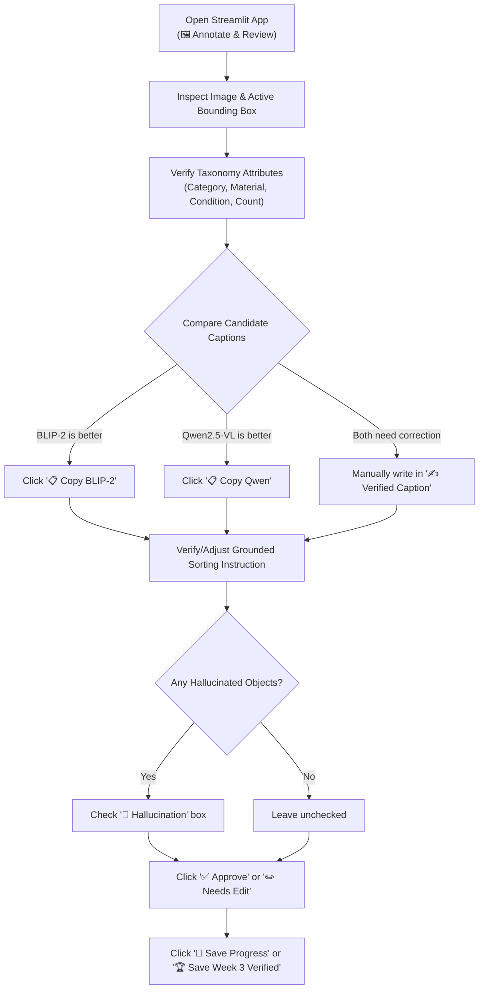

# 📋 Annotation & Review Guidelines

## Overview
This document guides human reviewers through verifying, editing, and curating waste image captions using the **Streamlit Waste Caption Curation App** (`streamlit run app/app.py`).

---

## 1. Review Objectives
Each waste item in the dataset requires human validation across four primary dimensions:
1. **Factual Correctness**: Does the caption accurately describe the object visible inside the bounding box?
2. **Taxonomic Granularity**: Are the object's **category**, **material**, and **condition** attributes accurate according to the unified taxonomy?
3. **No Hallucination**: Does the description invent non-existent objects, people, vehicles, or false brand names?
4. **Action Grounding**: Is there an actionable natural-language sorting instruction tied to the object?

---

## 2. Review Status Definitions

| Status | When to Use | Action in App |
|---|---|---|
| **Approved** (`approved`) | Caption is accurate or easily corrected. Taxonomy attributes, count, and sorting instruction are verified. | Click **✅ Approve** |
| **Needs Edit** (`needs_edit`) | Object is visible, but the description is vague or material is ambiguous; requires secondary inspection. | Click **✏️ Needs Edit** |
| **Rejected** (`rejected`) | Bounding box is misaligned, empty, entirely occluded, or caption is unrecoverably inaccurate. | Click **❌ Reject** |
| **Pending** (`pending`) | Unreviewed record (default state). | — |

---

## 3. Step-by-Step Curation Workflow in Streamlit

---

## 4. Taxonomy Reference Rules

### Waste Categories (12)
1. `plastic_bottle`: Beverage bottles, water bottles, detergent bottles with necks.
2. `glass_bottle`: Glass beverage bottles, jars, glass flasks.
3. `metal_can`: Aluminum soda cans, tin food cans, aerosol spray cans.
4. `drink_carton`: Tetra Pak style juice/milk cartons (multilayer composite).
5. `food_container`: Plastic clamshell boxes, takeaway tubs, yogurt cups.
6. `plastic_bag_wrapper`: Plastic shopping bags, snack wrappers, cling film.
7. `cup_lid`: Disposable drink cups, plastic bottle caps, metal crown caps.
8. `cardboard_box`: Corrugated shipping boxes, pizza boxes.
9. `paper_tissue`: Napkins, receipts, newspaper, writing paper.
10. `styrofoam`: Expanded polystyrene foam cups, food trays, packaging peanuts.
11. `cigarette_butt`: Cigarette filters, tobacco butts.
12. `other_litter`: Items not fitting above (straws, ropes, shoes, batteries).

### Materials (7)
- `plastic_rigid`: Hard, shaped plastic (bottles, caps, tubs).
- `plastic_film`: Flexible, crinkly or stretchy film (grocery bags, food wrappers).
- `metal_aluminum`: Lightweight drink cans, foil.
- `metal_steel`: Rigid food cans, bottle caps.
- `glass`: Transparent or colored silica glass.
- `paper_cardboard`: Paper fibers, corrugated boards.
- `composite_multilayer`: Laminated material (Tetra Pak, metallized crisp packets).

### Physical Conditions (Select all that apply)
- `intact`: Unbroken, original shape largely retained.
- `crushed`: Flattened, compressed, or crumpled plastic/metal body.
- `torn_shredded`: Ripped into parts or ragged edges.
- `flattened`: Pressed flat against the ground.
- `crumpled`: Wrinkled paper, film, or foil.
- `dirty_soiled`: Mud, grease, liquid staining, organic debris attached.
- `liquid_filled`: Containing residual beverage or water.
- `partially_occluded`: Covered partially by leaves, soil, or other litter.

---

## 5. Sorting Instruction Format
Standard format for robotic action policies:
- Format: `"[Action Verb] the [object category] and [disposal/cleaning destination]."`
- Examples:
  - *"Pick up the plastic bottle and place in the plastic recycling bin."*
  - *"Separate flexible film from conveyor to prevent roller entanglement."*
  - *"Clean food residue before depositing food container into rigid plastics bin."*

---

## 6. Flagging Hallucinations
Always check the **🚩 Hallucination** checkbox if the caption mentions:
- Humans ("person", "man", "woman", "hand", "foot") when no human is in the image.
- Vehicles ("car", "bicycle", "truck") in natural litter scenes.
- Living animals ("dog", "bird") or unnatural objects ("sofa", "laptop").

